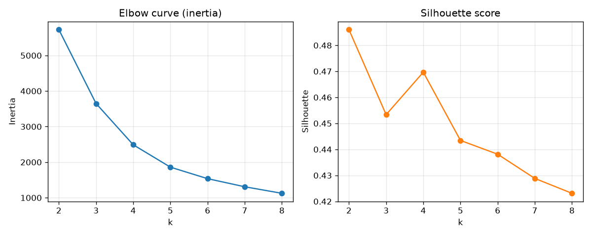
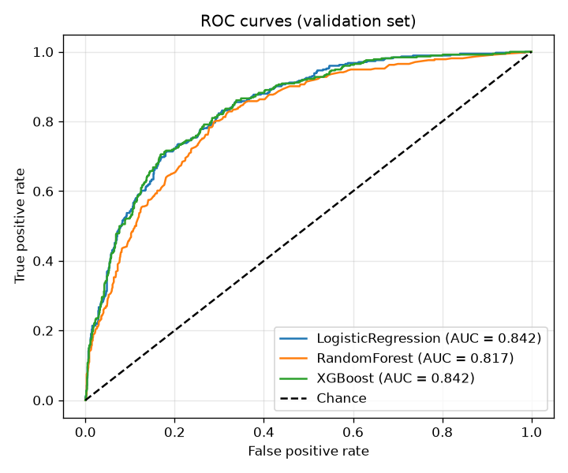

# Telco Churn Model

Branch: feature/churn-model

- churn_eda.ipynb: Task 1 (data checks, 20% hold-out split, 5 EDA charts, assumptions, metric)
- churn_baselines.ipynb: Task 2 (feature engineering, pipelines, baseline CV)
- results/baseline_results.csv: created after running churn_baselines.ipynb

Dataset: Telco Customer Churn. Put WA_Fn-UseC_-Telco-Customer-Churn.csv in the same folder if no internet.

# week 2 weekly assessment
## Task 3 - Models: Supervised and Unsupervised

Files: `classifier.py` (output `out3.txt`), `task3_regression.py` (output `out3b.txt`), `kmeans.py`, shared helpers in `common.py`.

### Classifiers (all inside pipelines, validation set)

| Model | Accuracy | ROC-AUC |
|---|---|---|
| LogisticRegression | 0.8084 | 0.8421 |
| DecisionTree (max_depth=5) | 0.7921 | 0.8162 |
| RandomForest (300 trees) | 0.7850 | 0.8170 |
| XGBoost (early stopping on validation) | 0.8105 | 0.8419 |

RandomForest OOB score, XGBoost best iteration, predict_proba vs predict for 5 rows and the top 5 features are in `out3.txt`. predict is 1 only when the churn probability is above 0.5.

### Regression (target = MonthlyCharges)

| Model | R2 | MAE | RMSE |
|---|---|---|---|
| LinearRegression | 0.9989 | 0.780 | 1.033 |
| Ridge (alpha=1) | 0.9989 | 0.780 | 1.034 |
| Lasso (alpha=0.5) | 0.9916 | 2.258 | 2.807 |

- Telco has no loan amount, so MonthlyCharges is the numeric target. TotalCharges was left out so the target does not leak.
- 41 features after encoding. Ridge keeps all 41, Lasso set 26 coefficients exactly to zero (feature selection).
- Biggest coefficients are service columns (InternetService Fiber optic, StreamingTV, StreamingMovies), because MonthlyCharges is the sum of service prices.

### K-Means segments (tenure, MonthlyCharges, TotalCharges)

Best k by silhouette score is 2 (k = 2 to 8 tested).

- Segment 0: 1436 customers, long tenure (about 57 months), high monthly charges (about 89), churn 17%. Loyal, high-value.
- Segment 1: 2789 customers, short tenure (about 20 months), low monthly charges (about 52), churn 31%. Newer customers who leave more often.
- Churn was not used for clustering, only to describe the segments.

## Task 4 - Evaluation and Tuning

Files: `metrics.py` (`out4.txt`), `tuning.py` (`out4b.txt`), `final_test.py` (`out4c.txt`).

### Metrics for every classifier (validation set, threshold 0.5)

| Model | Accuracy | Precision | Recall | F1 | ROC-AUC |
|---|---|---|---|---|---|
| LogisticRegression | 0.8084 | 0.6745 | 0.5374 | 0.5982 | 0.8421 |
| DecisionTree | 0.7921 | 0.6709 | 0.4251 | 0.5205 | 0.8162 |
| RandomForest | 0.7850 | 0.6320 | 0.4545 | 0.5288 | 0.8170 |
| XGBoost | 0.8105 | 0.7019 | 0.4973 | 0.5822 | 0.8419 |

Confusion matrices are in `out4.txt`.

Why accuracy misleads: about 73.5% of customers stay and 26.5% churn. A dummy model that always predicts "stay" gets 73.5% accuracy but finds 0% of churners. So accuracy 0.80 looks good while recall is only 0.43 to 0.54. Recall, precision, F1 and ROC-AUC show how well churners are really found.

### ROC curves (3 models, one chart)

### Threshold for at least 75% recall

Best model on validation: LogisticRegression. Threshold 0.294 (default 0.5) gives recall 0.751, precision 0.534, F1 0.624 on validation. Lower threshold catches more churners but gives more false alarms.

### Hyperparameter tuning (train set, 3-fold CV, ROC-AUC)

| Model | Search | CV ROC-AUC | Validation ROC-AUC |
|---|---|---|---|
| RandomForest | GridSearchCV (n_estimators, max_depth, min_samples_leaf) | 0.8480 | 0.8368 |
| XGBoost | RandomizedSearchCV (n_iter=15) | 0.8511 | 0.8420 |

Best parameters are in `out4b.txt`. Tuning improved RandomForest AUC from 0.8170 to 0.8368. XGBoost stayed about the same.

### Regression vs mean baseline (validation set)

| Model | MAE | RMSE | R2 |
|---|---|---|---|
| Mean baseline | 26.840 | 30.582 | -0.0004 |
| LinearRegression | 0.780 | 1.033 | 0.9989 |
| Ridge (alpha=1) | 0.780 | 1.034 | 0.9989 |
| Lasso (alpha=0.5) | 2.258 | 2.807 | 0.9916 |

### Final evaluation on the test set (used once)

The best model (LogisticRegression, validation ROC-AUC 0.8421) and the 0.294 threshold were chosen on the validation set only. The test set was then used one time.

| Threshold | Accuracy | Precision | Recall | F1 |
|---|---|---|---|---|
| 0.5 | 0.8056 | 0.6634 | 0.5428 | 0.5971 |
| 0.294 | 0.7573 | 0.5295 | 0.7674 | 0.6266 |

At threshold 0.294 the model finds 287 of the 374 churners in the test set (recall 0.767), so the 75% recall target also holds on unseen data. The price is 255 false alarms.

## Notes

- Test set was kept aside until the last step and used once.
- All preprocessing is inside pipelines, so it is fitted on training data only.
- Text columns are detected with `dtype.kind` because newer pandas stores strings as `str` instead of `object`.

